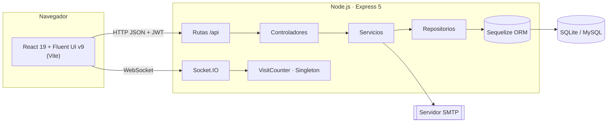

# 2. Diseño y arquitectura

## 2.1 Arquitectura general

Aplicación de tres capas: cliente SPA, API REST y base de datos relacional, más un canal en tiempo real para el contador de usuarios conectados.



En producción Express también sirve el build del frontend (`frontend/dist`), así todo se implementa en un solo servidor.

## 2.2 Capas del backend (POO)

| Capa | Clases | Responsabilidad |
| --- | --- | --- |
| Aplicación | `App` | Middlewares (Helmet, CORS, JSON, logs), rutas y archivos estáticos |
| Rutas | `crearRutas()` | Mapea verbos HTTP a controladores; aplica `requireAdmin` y límites |
| Controladores | `PlanController`, `SugerenciaController`, `AuthController`, `ContratacionController`, `DashboardController`, `ContenidoController`, `VisitaController` | Leen la petición y responden; sin lógica de negocio |
| Servicios | `PlanService`, `AuthService`, `SugerenciaService`, `ContratacionService`, `DashboardService`, `ExportService`, `ChatbotService`, `MailService`, `VisitCounter` | Reglas de negocio |
| Repositorios | `BaseRepository` → `PlanRepository`, `ContratacionRepository`, `SugerenciaRepository` | Consultas con el ORM; herencia para CRUD y paginación comunes |
| Modelos | `Plan`, `Cliente`, `Contratacion`, `Sugerencia`, `Administrador`, `PreguntaFrecuente`, `EmpresaCliente`, `Estadistica` | Clases que extienden `Model` de Sequelize, con validaciones |
| Configuración | `Database` (Singleton), `env` | Conexión única y variables de entorno |

## 2.3 Patrones de diseño

- **Singleton.** `Database.getInstance()` devuelve siempre la misma conexión de Sequelize; el constructor lanza un error si se usa con `new` (campo privado `#creando`). También son Singleton `MailService` (un solo transporte SMTP), `VisitCounter` (un solo contador compartido por la API y Socket.IO) y, en el frontend, `ApiClient` (guarda el token del administrador). Hay pruebas automáticas que lo comprueban.
- **Repository.** Aísla el acceso a datos; los servicios no conocen Sequelize.
- **MVC / capas.** Modelo (Sequelize), controlador (Express), vista (React).
- **Inyección por constructor.** Los servicios y controladores reciben su dependencia (`new PlanController(service)`), lo que facilita las pruebas.

## 2.4 Estructura de directorios

```
proyecto/
├── backend/
│   ├── src/
│   │   ├── config/         env.js · Database.js (Singleton)
│   │   ├── models/         clases del ORM y relaciones
│   │   ├── repositories/   BaseRepository y repositorios concretos
│   │   ├── services/       reglas de negocio, PDF/Excel, correo, chatbot, visitas
│   │   ├── controllers/    clases que atienden las rutas
│   │   ├── routes/         API REST
│   │   ├── middleware/     autenticación y manejo de errores
│   │   ├── seed/           datos de demostración
│   │   ├── utils/          HttpError, fechas
│   │   ├── app.js          clase App
│   │   └── server.js       arranque (HTTP + Socket.IO)
│   └── tests/              pruebas de la API (node:test + supertest)
├── frontend/
│   ├── public/             favicon, logos de clientes (SVG), media (video, audio)
│   └── src/
│       ├── theme/          tema Fluent, movimiento, superficies
│       ├── context/        tema claro/oscuro y sesión
│       ├── services/       ApiClient (Singleton)
│       ├── hooks/          carga de datos, avisos, visitas en vivo
│       ├── components/     shell (barra, navegación), ui (Page, Surface…), chatbot, ilustraciones
│       └── features/       inicio, planes, clientes, faq, contacto, admin
├── herramientas/           generar_multimedia.py, generar_gantt.mjs
└── docs/                   esta documentación
```

## 2.5 Diseño de interfaz (Fluent 2)

El sitio usa el mismo sistema de diseño de **TutoriasU**, basado en la guía Fluent 2 de Microsoft:

- **Componentes:** `@fluentui/react-components` v9 (Button, Field, Dropdown, Dialog, Accordion, Carousel, Table, Toast…) y `@fluentui/react-charts` para las gráficas.
- **Marca:** rampa `#456ad1` (tono 80) generada en OKLCH, igual a TutoriasU; tema claro y oscuro con los ajustes de contraste de texto de marca en oscuro.
- **Estilos:** Griffel (`makeStyles` + `tokens`); ningún color literal en componentes de interfaz. Espaciado en escala de 4 px.
- **Capas:** base tipo Mica (neutro + 5 % de marca) para barra y navegación, lienzo `colorNeutralBackground2`, tarjetas `colorNeutralBackground1` con `shadow4` y radio de 12 px.
- **Tipografía:** Segoe UI Variable; título de página `Title2` (móvil `Title3`), un solo `h1` por pantalla.
- **Parte privada:** ventana estilo app de Windows (barra de 48 px, riel de íconos con las cuatro escuadras de marca, panel acrílico al abrir el menú), copiada de TutoriasU.
- **Movimiento:** fundido de página de 200 ms, `liftOnHover` en tarjetas clicables; todo se desactiva con `prefers-reduced-motion`.
- **Ilustraciones:** SVG propios con tokens (funcionan en claro y oscuro), una metáfora por imagen.

## 2.6 API REST

Base: `/api`. JSON en peticiones y respuestas. Las rutas privadas requieren `Authorization: Bearer <token>`.

| Método | Ruta | Acceso | Descripción |
| --- | --- | --- | --- |
| GET | `/salud` | Público | Estado del servicio |
| POST | `/auth/login` | Público | Devuelve `{ token, administrador }` |
| GET | `/auth/perfil` | Admin | Datos del administrador |
| GET | `/planes?q&tipo&precioMax&orden` | Público | Búsqueda de planes (`todos=true` con token incluye ocultos) |
| GET | `/planes/tipos` | Público | Tipos de plan |
| GET | `/planes/:id` | Público | Detalle |
| GET | `/planes/:id/ficha` | Público | Ficha técnica PDF |
| GET | `/planes/catalogo/pdf?q&tipo…` | Público | Resultados de búsqueda en PDF |
| POST/PUT/DELETE | `/planes[/:id]` | Admin | Altas, cambios y bajas |
| POST | `/sugerencias` | Público | Formulario de contacto (guarda y envía correo) |
| GET | `/sugerencias?page&pageSize&q&leida` | Admin | Listado paginado |
| GET | `/sugerencias/exportar/excel` · `/pdf` | Admin | Exportaciones |
| PATCH/DELETE | `/sugerencias/:id` | Admin | Marcar leída / eliminar |
| GET/POST/PUT/DELETE | `/contrataciones[/:id]` | Admin | Mantenimiento de contrataciones |
| GET | `/clientes` | Admin | Clientes |
| GET | `/dashboard/planes-por-tipo` | Admin | Dashboard 1 |
| GET | `/dashboard/vencimientos?dias=10` | Admin | Dashboard 2 |
| GET | `/preguntas-frecuentes` · `/empresas-cliente` | Público | Contenido |
| POST | `/chatbot` | Público | `{ mensaje }` → `{ texto, enlace?, sugerencias[] }` |
| POST/GET | `/visitas` | Público | Registrar visita / resumen |

Errores: `{ error: "mensaje", campos?: { campo: "mensaje" } }` con 400, 401, 404, 409 o 500.
