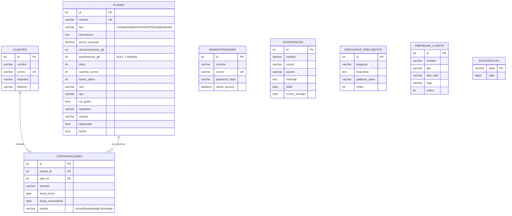

# 3. Modelo físico de la base de datos

El ORM **Sequelize** crea las tablas a partir de las clases de `backend/src/models`. En desarrollo se usa SQLite (`backend/data/hosting.sqlite`); para producción se cambia a MySQL con `DB_DIALECT=mysql` sin tocar el código. El script equivalente para MySQL está en [`schema.sql`](schema.sql).

## 3.1 Diagrama entidad-relación



Todas las tablas tienen además `created_at` y `updated_at` (los agrega el ORM).

## 3.2 Diccionario de datos resumido

| Tabla | Propósito | Reglas |
| --- | --- | --- |
| `planes` | Servicios del catálogo | Nombre único; tipo dentro de la lista; precio ≥ 0; `activo = 0` lo oculta del sitio sin borrarlo |
| `clientes` | Personas o empresas que contratan | Correo único; al registrar una contratación se busca o crea el cliente por correo (transacción) |
| `contrataciones` | Plan contratado y su vigencia | `fecha_vencimiento ≥ fecha_inicio`; borrar un cliente borra sus contrataciones (CASCADE); no se puede borrar un plan con contrataciones (RESTRICT) |
| `administradores` | Acceso a la parte privada | Contraseña con bcrypt; nunca se devuelve en la API |
| `sugerencias` | Formulario de contacto | Correo válido; mensaje de 10 a 4000 caracteres; `correo_enviado` indica si salió el correo |
| `preguntas_frecuentes` | Acordeón y base de conocimiento del chatbot | `palabras_clave` alimenta la búsqueda del chatbot |
| `empresas_cliente` | Sección "Clientes" | `sitio_web` debe ser URL; `logo` apunta a un SVG optimizado |
| `estadisticas` | Contador de visitas | Clave `visitas_totales`; se incrementa con `UPDATE … SET valor = valor + 1` |

## 3.3 Consultas de los dashboards (generadas por el ORM)

Dashboard 1 — contrataciones activas por tipo de plan:

```sql
SELECT p.tipo, COUNT(c.id) AS total
FROM contrataciones c JOIN planes p ON p.id = c.plan_id
WHERE c.estado = 'Activa'
GROUP BY p.tipo;
```

Dashboard 2 — contrataciones que vencen en los próximos 10 días:

```sql
SELECT c.*, cl.nombre, p.nombre, p.precio_mensual
FROM contrataciones c
JOIN clientes cl ON cl.id = c.cliente_id
JOIN planes p ON p.id = c.plan_id
WHERE c.estado = 'Activa'
  AND c.fecha_vencimiento BETWEEN CURRENT_DATE AND CURRENT_DATE + INTERVAL 9 DAY
ORDER BY c.fecha_vencimiento;
```
