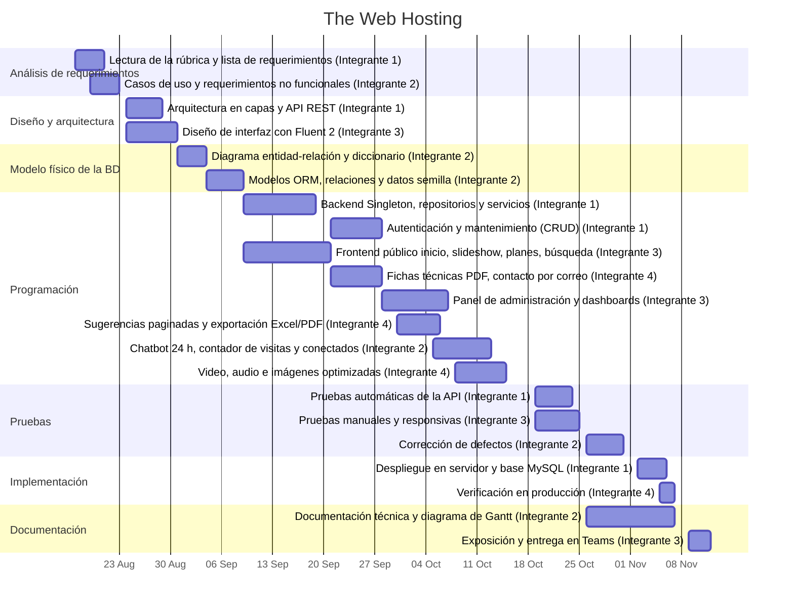

# 7. Diagrama de Gantt

Asignaciones y tiempos de cada integrante del equipo. La versión con barras de colores está en [`diagrama-gantt.xlsx`](diagrama-gantt.xlsx).

> **Antes de entregar:** reemplaza "Integrante 1…4" y las fechas por los datos reales del equipo en `herramientas/gantt.json` y ejecuta `node herramientas/generar_gantt.mjs`. Se regeneran este archivo y el Excel.

Periodo: 2026-08-17 a 2026-11-11 (87 días naturales).

## Asignaciones

| Fase | Tarea | Responsable | Inicio | Fin | Días |
| --- | --- | --- | --- | --- | --- |
| 1. Análisis de requerimientos | Lectura de la rúbrica y lista de requerimientos | Integrante 1 | 2026-08-17 | 2026-08-20 | 4 |
| 1. Análisis de requerimientos | Casos de uso y requerimientos no funcionales | Integrante 2 | 2026-08-19 | 2026-08-22 | 4 |
| 2. Diseño y arquitectura | Arquitectura en capas y API REST | Integrante 1 | 2026-08-24 | 2026-08-28 | 5 |
| 2. Diseño y arquitectura | Diseño de interfaz con Fluent 2 | Integrante 3 | 2026-08-24 | 2026-08-30 | 7 |
| 3. Modelo físico de la BD | Diagrama entidad-relación y diccionario | Integrante 2 | 2026-08-31 | 2026-09-03 | 4 |
| 3. Modelo físico de la BD | Modelos ORM, relaciones y datos semilla | Integrante 2 | 2026-09-04 | 2026-09-08 | 5 |
| 4. Programación | Backend: Singleton, repositorios y servicios | Integrante 1 | 2026-09-09 | 2026-09-18 | 10 |
| 4. Programación | Autenticación y mantenimiento (CRUD) | Integrante 1 | 2026-09-21 | 2026-09-27 | 7 |
| 4. Programación | Frontend público: inicio, slideshow, planes, búsqueda | Integrante 3 | 2026-09-09 | 2026-09-20 | 12 |
| 4. Programación | Fichas técnicas PDF, contacto por correo | Integrante 4 | 2026-09-21 | 2026-09-27 | 7 |
| 4. Programación | Panel de administración y dashboards | Integrante 3 | 2026-09-28 | 2026-10-06 | 9 |
| 4. Programación | Sugerencias paginadas y exportación Excel/PDF | Integrante 4 | 2026-09-30 | 2026-10-05 | 6 |
| 4. Programación | Chatbot 24 h, contador de visitas y conectados | Integrante 2 | 2026-10-05 | 2026-10-12 | 8 |
| 4. Programación | Video, audio e imágenes optimizadas | Integrante 4 | 2026-10-08 | 2026-10-14 | 7 |
| 5. Pruebas | Pruebas automáticas de la API | Integrante 1 | 2026-10-19 | 2026-10-23 | 5 |
| 5. Pruebas | Pruebas manuales y responsivas | Integrante 3 | 2026-10-19 | 2026-10-24 | 6 |
| 5. Pruebas | Corrección de defectos | Integrante 2 | 2026-10-26 | 2026-10-30 | 5 |
| 6. Implementación | Despliegue en servidor y base MySQL | Integrante 1 | 2026-11-02 | 2026-11-05 | 4 |
| 6. Implementación | Verificación en producción | Integrante 4 | 2026-11-05 | 2026-11-06 | 2 |
| 7. Documentación | Documentación técnica y diagrama de Gantt | Integrante 2 | 2026-10-26 | 2026-11-06 | 12 |
| 7. Documentación | Exposición y entrega en Teams | Integrante 3 | 2026-11-09 | 2026-11-11 | 3 |

## Carga por integrante

| Integrante | Tareas | Días asignados |
| --- | --- | --- |
| Integrante 1 | 6 | 35 |
| Integrante 2 | 6 | 38 |
| Integrante 3 | 5 | 37 |
| Integrante 4 | 4 | 22 |
